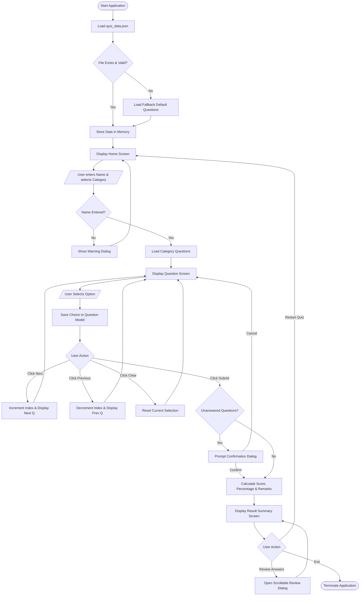

# MICRO-PROJECT REPORT

## Project Title: Desktop Interactive Quiz Application using Python and Tkinter
**Academic Level**: 3rd Semester Diploma in Computer Science & Engineering  
**Technology Stack**: Python 3.x, Tkinter GUI, JSON Storage  

---

## 1. Introduction
In modern education, objective evaluations and digital quizzes have become vital instruments for assessing students' conceptual clarity. Traditional paper-based quizzes consume paper, require manual correction, and do not provide immediate interactive feedback.

The **Desktop Interactive Quiz Application** is a lightweight, graphical user interface (GUI) application designed to automate testing and self-assessment. Developed using Python's built-in **Tkinter** library and structured around a **JSON-driven question database**, the application offers multiple categories, dynamic single-question displays, bidirectional navigation, automatic scoring, and comprehensive answer reviews.

---

## 2. Objectives of the Project
The primary objectives of this micro-project are:
1. To develop a cross-platform desktop quiz application using Python and Tkinter.
2. To demonstrate fundamental and intermediate Python programming concepts:
   - Object-Oriented Programming (Classes and Objects)
   - File I/O operations with structured JSON data
   - Robust Exception Handling to prevent crashes
   - Data structures (Lists, Dictionaries, Tuples)
   - Event-driven programming with Tkinter
3. To provide an intuitive, responsive user interface suitable for academic testing and demonstrations.
4. To allow easy scalability so that new categories and questions can be added without altering the source code.

---

## 3. System Requirements

### 3.1 Hardware Requirements
- **Processor**: Intel Core i3 (2.0 GHz) or AMD equivalent (or higher).
- **RAM**: Minimum 2 GB (4 GB recommended).
- **Storage**: Minimum 50 MB free disk space.
- **Display**: Standard 1366x768 resolution or higher (1920x1080 supported with High-DPI scaling).
- **Peripherals**: Keyboard and Mouse/Trackpad.

### 3.2 Software Requirements
- **Operating System**: Windows 10 / 11, Linux, or macOS.
- **Programming Language**: Python 3.8 to Python 3.14.
- **Integrated Development Environment (IDE)**: Visual Studio Code, PyCharm, or Python IDLE.
- **Libraries/Packages**: Built-in Python modules only (`tkinter`, `ttk`, `json`, `os`, `sys`). No external `pip` dependencies required.

---

## 4. Methodology & Software Architecture

The application adopts a **Model-View-Controller (MVC)** inspired architecture:

1. **Model Layer (`quiz_engine.py`)**:
   - `Question`: Data class encapsulating question id, text, choices, correct answer, student response, and explanation.
   - `QuizManager`: Manages question lists, active indices, scoring formulas, and JSON file parsing.
2. **View & Controller Layer (`main.py`)**:
   - `QuizApp`: Inherits from `tk.Tk` to create the master window and coordinate transitions between three main views:
     - **Home View**: Student onboarding, category selection, and validation.
     - **Quiz View**: Question card rendering, radio selection, and navigation handlers.
     - **Result View & Review Modal**: Summary calculation, grade generation, and detailed answer examination.
3. **Data Storage Layer (`quiz_data.json`)**:
   - Stores hierarchical JSON data categorized under "Python Programming", "Computer Fundamentals", and "General Knowledge".

---

## 5. Flowchart and Algorithm

### 5.1 Step-by-Step Algorithm
1. **Start**: Launch the application.
2. **Initialize Engine**: Load and parse `quiz_data.json`. If missing or invalid, trigger `try-except` fallback to default questions.
3. **Home Screen**:
   - Display project title, student name entry field, and radio choices for available categories.
   - Wait for user action.
4. **Validation**:
   - If Student Name is blank, show Warning Dialog and focus entry.
   - If valid, initialize quiz state with selected category questions and reset score.
5. **Display Question**:
   - Retrieve current question index `i`.
   - Update header counter (`Question i of N`) and progress bar.
   - Render question text and 4 multiple-choice options.
   - If user already selected an option for this question, pre-select it.
6. **User Interaction**:
   - User clicks an option: Update current question's user answer.
   - User clicks `Previous`: If `i > 0`, decrement `i` and go to Step 5.
   - User clicks `Clear Choice`: Clear selection for question `i`.
   - User clicks `Next`: If `i < N - 1`, increment `i` and go to Step 5.
   - User clicks `Submit Quiz`:
     - Check if any questions are unattempted.
     - If unattempted > 0, display confirmation dialog.
7. **Score Evaluation**:
   - Compare each question's `user_answer` with `correct_answer`.
   - Compute `Correct`, `Incorrect`, and `Skipped` counts.
   - Compute `Percentage = (Correct / Total) * 100`.
   - Determine Grade and Performance Remark via `if-elif-else`.
8. **Result Screen**:
   - Display score banner, grade, percentage, and metric breakdown boxes.
   - Option A: Click `Review Answers` -> Open scrollable modal with detailed review.
   - Option B: Click `Restart Quiz` -> Reset session and return to Home Screen.
   - Option C: Click `Exit` -> Confirm and terminate application (`destroy()`).
9. **End**: Close program.

### 5.2 Flowchart (Mermaid)

---

## 6. Detailed Module Description

### 6.1 `quiz_data.json`
Acts as an external persistent database structured with a top-level `"categories"` dictionary. Each category contains an array of question objects having:
- `id`: Unique numeric identifier.
- `question`: The text of the question.
- `options`: List of 4 distinct choices.
- `answer`: The exact string of the correct choice.
- `explanation`: Contextual reason explaining why that answer is right.

### 6.2 `quiz_engine.py`
- `Question` class: Demonstrates encapsulation by encapsulating question parameters and providing helper methods like `is_attempted()` and `is_correct()`.
- `QuizManager` class: Implements business logic:
  - `load_data()`: Demonstrates `try-except` file handling.
  - `start_quiz()`: Filters questions and initializes current session.
  - `calculate_results()`: Aggregates metrics, calculates percentages, and assigns performance feedback.

### 6.3 `main.py`
- `QuizApp` class: Inherits from `tk.Tk`. Manages application windows, frames, High-DPI Windows awareness, responsive widgets, and TTK styling.
- `show_home_screen()`: Collects user information and configures the quiz.
- `show_quiz_screen()`: Dynamically redraws widgets for the active question.
- `show_result_screen()`: Visualizes metrics and performance grade.
- `open_review_modal()`: Creates a modal `tk.Toplevel` with a `Canvas` and `Scrollbar` to examine past choices.

---

## 7. Python Concepts Demonstrated

1. **Variables and Data Types**:
   - String (`str`), Integer (`int`), Float (`float`), Boolean (`bool`), and `NoneType`.
2. **Data Structures**:
   - Lists (`[]`): Managing option choices and question arrays.
   - Dictionaries (`{}`): Mapping JSON category keys and question objects.
3. **Control Flow (Conditionals & Loops)**:
   - `if-elif-else`: Rating performance brackets (90%+, 75%+, 60%+, etc.).
   - `for` loops and `enumerate()`: Iterating through questions and options.
4. **Functions & Object Methods**:
   - Modular functions with type annotations, docstrings, and event callbacks.
5. **File Handling**:
   - Context manager `with open(..., 'r', encoding='utf-8')` ensures safe file closing.
6. **Exception Handling**:
   - Defensive programming catching `FileNotFoundError`, `json.JSONDecodeError`, and generic `Exception`.
7. **Object-Oriented Programming (OOP)**:
   - Encapsulation: Combining question data and behavior inside `Question`.
   - Inheritance: `QuizApp` inheriting from `tk.Tk`.
8. **JSON Data Format**:
   - Industry-standard serialization using Python's native `json` module.

---

## 8. Advantages of the Project
- **Zero External Dependencies**: Built entirely on standard Python modules; runs immediately on any system with Python installed.
- **Easy Maintenance**: Content creators can modify or expand questions in `quiz_data.json` without programming experience.
- **Prevents Duplicate Submission**: Internal tracking records answers per question, allowing non-destructive navigation.
- **High-DPI Awareness**: Clean, non-blurry fonts on modern high-resolution Windows screens.
- **Educational Review**: The review screen reinforces learning by explaining the rationale behind correct answers.

---

## 9. Limitations
- Does not currently support timed quizzes (countdown timer).
- Scores are displayed locally for the session and not saved to an external database like SQLite or MySQL.
- Does not include randomized question ordering (questions appear sequentially).

---

## 10. Future Enhancements
- Implement a countdown timer per question or per category using `root.after()`.
- Add sound effects for correct and incorrect answers.
- Connect an SQLite database to maintain a permanent leaderboard of past student scores.
- Add an admin panel to add/edit questions directly from the GUI.

---

## 11. Conclusion
The **Python Desktop Quiz Application** fulfills all requirements of a 3rd-semester Diploma in Computer Science Engineering micro-project. It successfully integrates modern GUI design, structured data handling, exception safety, and object-oriented programming. The application is completely functional, student-friendly, and ready for laboratory examination and viva defense.
